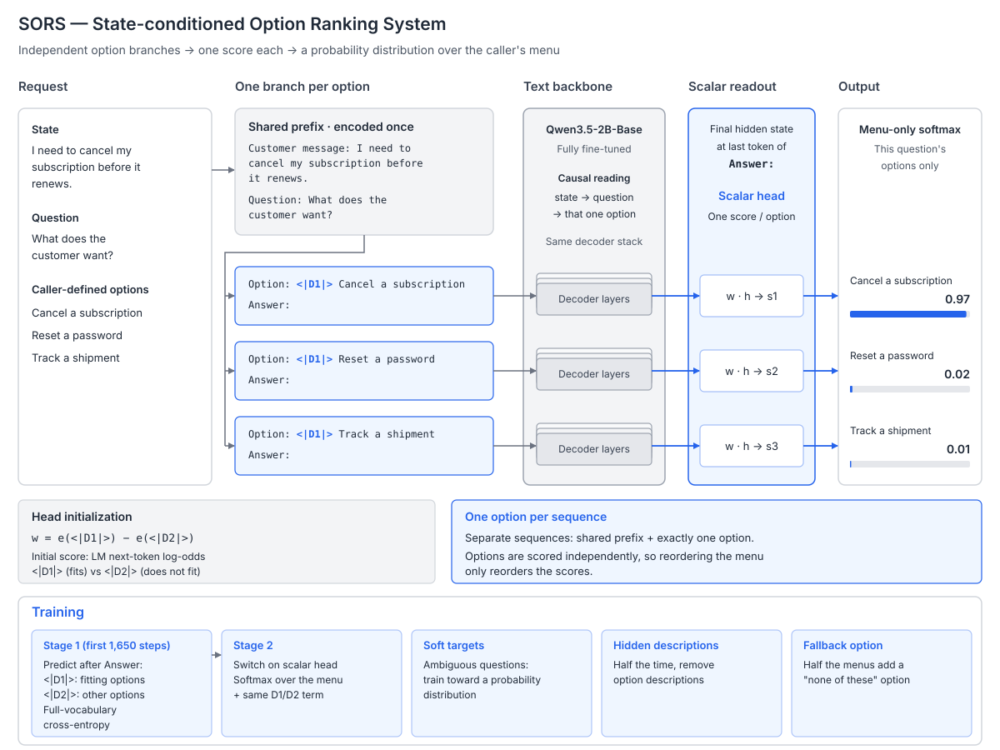

# SORS

**State-conditioned Option Ranking System**

[](LICENSE)

**English** | [简体中文](README.zh-CN.md)

Given a state, a set of questions and options defined by the caller, SORS returns a probability distribution over those options and nothing else.

**Model:** [🤗 SakuraYuyuko/Sors-2B](https://huggingface.co/SakuraYuyuko/Sors-2B)



SORS scores every option on its own. For each question it builds one branch per option: the shared prefix (state, then question) followed by
`Option: <|D1|> <option text>` and `Answer:`. The prefix is encoded once and reused by every branch, so a menu costs one pass over the state
plus a short suffix per option. The fully fine-tuned Qwen3.5 backbone reads each branch causally, and a scalar head on its final hidden state at
`Answer:` gives that option's score. A softmax over the question's own options turns the scores into probabilities. The caller chooses the option
names and how many there are, up to 255 per menu; a new set of options needs no retraining.

Because no branch sees another option, reordering the menu only reorders the scores, and an option's score does not depend on what else is on
the menu. The scalar head reads the normalised final hidden state and trains with the backbone from the first step on the softmax over each
question's menu. Ambiguous questions train toward a probability distribution instead of a single answer, half the questions hide option
descriptions, and half the menus add a "none of these" option.

## Benchmarks

Sors-2B is trained only on our own synthetic dataset, synth-intents-v6 (to be open-sourced once it is cleaned up): 56,990 questions in 33 domains,
English and Chinese, chosen family by family from the 516,464 questions of synth-intents-v5.25 and each seen once (845 steps at batch 72; see
[DATASETS.md](DATASETS.md)). None of the evaluation sets below take part in training. We wrote the synthetic data from scratch and it contains no
content from existing datasets. We compared the training material (37,354 distinct texts) against every evaluation set below: no text is identical
after normalisation; a run of 8 consecutive words is shared by no MASSIVE item, 3 of Banking77's 3,080 items, 4 of BoolQ's 3,270 and 1 public
JevBench item, all of them everyday phrases or lists such as "I don't want to be charged for" or a list of public holidays.

| Benchmark | Questions | [Sors-2B](https://huggingface.co/SakuraYuyuko/Sors-2B) | previous (2026-10-29) |
|---|---:|---:|---:|
| Banking77 | 3,080 | 67.5 | 67.0 |
| Banking77 + descriptions | 3,080 | 79.0 | 79.7 |
| MASSIVE | 2,974 | 71.9 | 68.6 |
| MASSIVE + descriptions | 2,974 | 81.9 | 80.4 |
| BoolQ | 3,270 | 84.9 | 81.1 |
| Public JevBench easy | 48 | 100.0 | 100.0 |
| Public JevBench original | 72 | 97.2 | 97.2 |
| Public JevBench hard | 111 | 71.2 | 66.7 |
| Public JevBench overall | 231 | 85.3 | 83.1 |
| Decision Index 0.3, public index | 140,620 | 27.68 | 21.22 |

Numbers are accuracy (%), except the Decision Index public index.

- **Banking77 and MASSIVE are answered against the full intent menu.** Every Banking77 question shows all 77 intents and every MASSIVE question shows all 60;
  no retriever or other model narrows them to a top-K shortlist first. "+ descriptions" adds a one-line description after each intent name.
- Calibration improved with the shorter training: expected calibration error on MASSIVE fell from 0.14 to 0.08 and on BoolQ from 0.064 to 0.043.
- Public JevBench is JevBench's public question set, scored with the official JevBench CLI and its `typesafe` adapter. Its tiers have only 48 / 72 / 111 questions, so differences of a few points there are noise; "overall" is accuracy over all 231 questions (197 correct).
- The Decision Index public index is our own run of the public Decision Index kit (edition 0.3, HTTP engine), not a leaderboard submission; 243 requests longer than the server's context count as wrong, as the kit prescribes.
- On the [JevBench leaderboard](https://benchmarkheaven.com/jev-models), the previous weights (2026-10-29) rank 165 of 261 overall, with intelligence 31.4 and calibration 76.5. The current weights have not been measured there yet.
- These are the weights released on 2026-11-18. Earlier weights remain available as Hugging Face revisions `v78-2026-10-29` (synth-intents-v5.17) and `v5.3-2026-10-08` (synth-intents-v5.3).

## Deployment

### Run directly

You need Python 3.13, [uv](https://docs.astral.sh/uv/) and a CUDA GPU.

```bash
uv sync
PYTHONPATH=src .venv/bin/python scripts/serve.py \
  --init SakuraYuyuko/Sors-2B --max-tokens 16384 --warmup --port 8000
```

When `--init` names a Hugging Face repository, the first start downloads the model into the standard HF cache (`~/.cache/huggingface`)
and later starts load it from there. Private repositories use the machine's `hf auth login` or `HF_TOKEN`. Add `--local-files-only`
to read only from the cache when offline; `--revision` selects a branch, tag or commit. `--init` also accepts a local model directory.
With `SORS_API_KEY` or `--api-key` set, requests need `Authorization: Bearer <key>`. `--demo` adds a playground page at `/demo/playground/`.

### Request

```bash
curl -s http://127.0.0.1:8000/v1/systemone \
  -H 'Content-Type: application/json' \
  -d '{
    "model": "Sors-2B",
    "state": "I need to cancel my subscription before it renews.",
    "questions": {
      "intent": {
        "type": "choice",
        "instructions": "What does the customer want?",
        "criteria": {
          "Cancel a subscription": null,
          "Reset a password": null,
          "Track a shipment": null
        }
      },
      "urgent": {
        "type": "noul",
        "instructions": "Does the customer need this done right away?"
      }
    }
  }'
```

`model` must match the served name. It defaults to the last part of the HF repository name or the model directory name, `Sors-2B` here,
and `--model-name` overrides it. One request can carry several questions that share the same `state`.

Response (probabilities are illustrative):

```json
{
  "model": "Sors-2B",
  "answers": {
    "intent": {
      "type": "choice",
      "choice": "Cancel a subscription",
      "probabilities": {"Cancel a subscription": 0.99, "Reset a password": 0.005, "Track a shipment": 0.005},
      "confidence": 0.985
    },
    "urgent": {"type": "noul", "noul": 0.71}
  },
  "usage": {"input_tokens": 118, "output_tokens": 2}
}
```

There are three question types. `choice` picks one of the caller's options (2–255, each with an optional description); `noul` is a yes/no question
and returns the probability of "yes"; `score` is an ordered scale.
`state`, `instructions` and option descriptions can each be a string or JSON.

### Docker

The same model directory can be mounted into a container; see [docker/README.md](docker/README.md) for building and running it.

## Tests

```bash
uv sync
SORS_DATASETS_DIR=../decidophobia-dataset HF_HUB_OFFLINE=1 .venv/bin/pytest
```

Runs in parallel on every core by default (pytest-xdist); add `-n0` to run serially while debugging one test.
`tests/*_gpu.py` are skipped unless you pass `--gpu`, which needs CUDA.

## License

Code is [MIT](LICENSE). Model weights follow Qwen's Apache-2.0. The API shape follows TypeSafe's
[System One](https://typesafe.ai/blog/introducing-system-one-models-and-jev); this project is not affiliated with TypeSafe AI.
