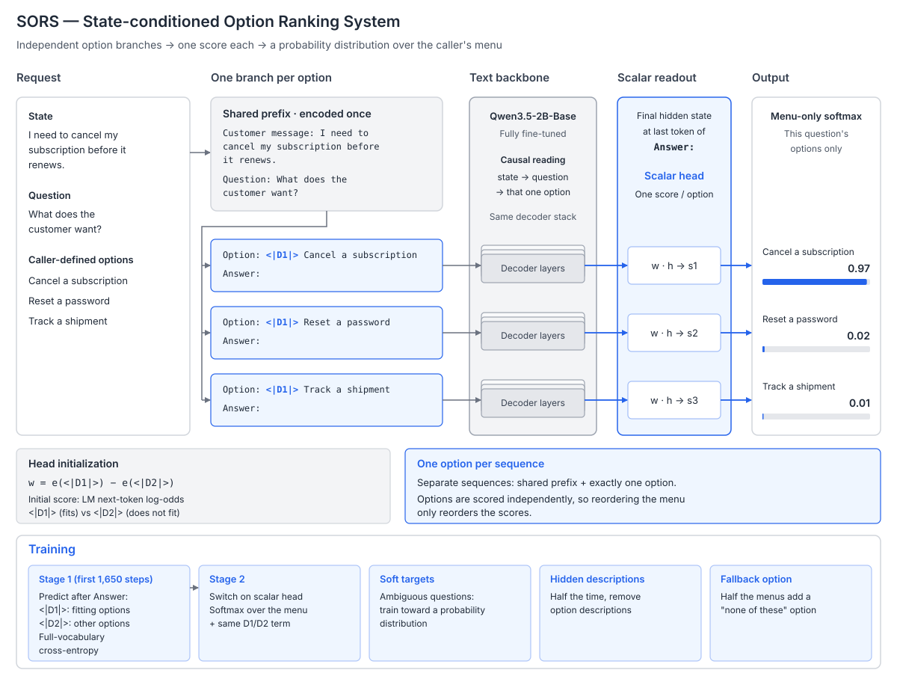

# SORS

**State-conditioned Option Ranking System**

[](LICENSE)

**English** | [简体中文](README.zh-CN.md)

Given a state, a set of questions and options defined by the caller, SORS returns a probability distribution over those options and nothing else.

**Model:** [🤗 SakuraYuyuko/Sors-2B](https://huggingface.co/SakuraYuyuko/Sors-2B)



SORS scores every option on its own. For each question it builds one branch per option: the shared prefix (state, then question) followed by
`Option: <|D1|> <option text>` and `Answer:`. The prefix is encoded once and reused by every branch, so a menu costs one pass over the state
plus a short suffix per option. The fully fine-tuned Qwen3.5 backbone reads each branch causally, and a scalar head on its final hidden state at
`Answer:` gives that option's score. A softmax over the question's own options turns the scores into probabilities. The caller chooses the option
names and how many there are, up to 255 per menu; a new set of options needs no retraining.

Because no branch sees another option, reordering the menu only reorders the scores, and an option's score does not depend on what else is on
the menu. The scalar head starts as the language model's log-odds that the next token is `<|D1|>` ("this option fits") rather than `<|D2|>`
("it does not"). Training first teaches the backbone that next-token choice for every option on its own, then switches the head on and trains
the softmax over the menu together with the same per-option term. Ambiguous questions train toward a probability distribution instead of a single
answer, half the questions hide option descriptions, and half the menus add a "none of these" option.

## Benchmarks

Sors-2B is trained only on our own synthetic dataset, synth-intents-v5.17 (370,639 questions in 26 domains; to be open-sourced once it is cleaned up);
none of the evaluation sets below take part in training. We wrote the synthetic data from scratch and it contains no content from existing datasets.
It deliberately stays out of Banking77's banking domain and MASSIVE's voice-assistant scenarios, and an automatic check blocks vocabulary from those domains.
We compared the training material (167,759 distinct texts) against every evaluation set below: no text is identical after normalisation;
no MASSIVE, BoolQ or JevBench item shares a run of 8 consecutive words with it; 5 of Banking77's 3,080 items share 8 words,
all of them everyday phrases such as "I don't want to be charged for".

| Benchmark | Questions | [Sors-2B](https://huggingface.co/SakuraYuyuko/Sors-2B) |
|---|---:|---:|
| Banking77 | 3,080 | 67.0 |
| Banking77 + descriptions | 3,080 | 79.7 |
| MASSIVE | 2,974 | 68.6 |
| MASSIVE + descriptions | 2,974 | 80.4 |
| BoolQ | 3,270 | 81.1 |
| Public JevBench easy | 48 | 100.0 |
| Public JevBench original | 72 | 97.2 |
| Public JevBench hard | 111 | 66.7 |
| Public JevBench overall | 231 | 83.1 |

Numbers are accuracy (%).

- **Banking77 and MASSIVE are answered against the full intent menu.** Every Banking77 question shows all 77 intents and every MASSIVE question shows all 60;
  no retriever or other model narrows them to a top-K shortlist first. "+ descriptions" adds a one-line description after each intent name.
- Option order: the same questions answered with their options shuffled into 5 random orders stay within 0.1 points of the table for Sors-2B,
  and the 5 orders pick the same option on 99.7–99.8% of Banking77 and MASSIVE questions and on every BoolQ question.
- Public JevBench is JevBench's public question set, scored with the official JevBench CLI and its `typesafe` adapter. Its tiers have only 48 / 72 / 111 questions, so differences of a few points there are noise; "overall" is accuracy over all 231 questions (192 correct). Results from the JevBench leaderboard will be added once available.
- These are the weights released on 2026-10-29. The 2026-10-08 weights, trained on synth-intents-v5.3, remain available as Hugging Face revision `v5.3-2026-10-08`.

## Deployment

### Run directly

You need Python 3.13, [uv](https://docs.astral.sh/uv/) and a CUDA GPU.

```bash
uv sync
PYTHONPATH=src .venv/bin/python scripts/serve.py \
  --init SakuraYuyuko/Sors-2B --warmup --port 8000
```

When `--init` names a Hugging Face repository, the first start downloads the model into the standard HF cache (`~/.cache/huggingface`)
and later starts load it from there. Private repositories use the machine's `hf auth login` or `HF_TOKEN`. Add `--local-files-only`
to read only from the cache when offline; `--revision` selects a branch, tag or commit. `--init` also accepts a local model directory.
With `SORS_API_KEY` or `--api-key` set, requests need `Authorization: Bearer <key>`. `--demo` adds a playground page at `/demo/playground/`.

### Request

```bash
curl -s http://127.0.0.1:8000/v1/systemone \
  -H 'Content-Type: application/json' \
  -d '{
    "model": "Sors-2B",
    "state": "I need to cancel my subscription before it renews.",
    "questions": {
      "intent": {
        "type": "choice",
        "instructions": "What does the customer want?",
        "criteria": {
          "Cancel a subscription": null,
          "Reset a password": null,
          "Track a shipment": null
        }
      },
      "urgent": {
        "type": "noul",
        "instructions": "Does the customer need this done right away?"
      }
    }
  }'
```

`model` must match the served name. It defaults to the last part of the HF repository name or the model directory name, `Sors-2B` here,
and `--model-name` overrides it. One request can carry several questions that share the same `state`.

Response (probabilities are illustrative):

```json
{
  "model": "Sors-2B",
  "answers": {
    "intent": {
      "type": "choice",
      "choice": "Cancel a subscription",
      "probabilities": {"Cancel a subscription": 0.99, "Reset a password": 0.005, "Track a shipment": 0.005},
      "confidence": 0.985
    },
    "urgent": {"type": "noul", "noul": 0.71}
  },
  "usage": {"input_tokens": 118, "output_tokens": 2}
}
```

There are three question types. `choice` picks one of the caller's options (2–255, each with an optional description); `noul` is a yes/no question
and returns the probability of "yes"; `score` is an ordered scale.
`state`, `instructions` and option descriptions can each be a string or JSON.

### Docker

The same model directory can be mounted into a container; see [docker/README.md](docker/README.md) for building and running it.

## Tests

```bash
uv sync
SORS_DATASETS_DIR=../decidophobia-dataset HF_HUB_OFFLINE=1 .venv/bin/pytest
```

Runs in parallel on every core by default (pytest-xdist); add `-n0` to run serially while debugging one test.
`tests/*_gpu.py` are skipped unless you pass `--gpu`, which needs CUDA.

## License

Code is [MIT](LICENSE). Model weights follow Qwen's Apache-2.0. The API shape follows TypeSafe's
[System One](https://typesafe.ai/blog/introducing-system-one-models-and-jev); this project is not affiliated with TypeSafe AI.
